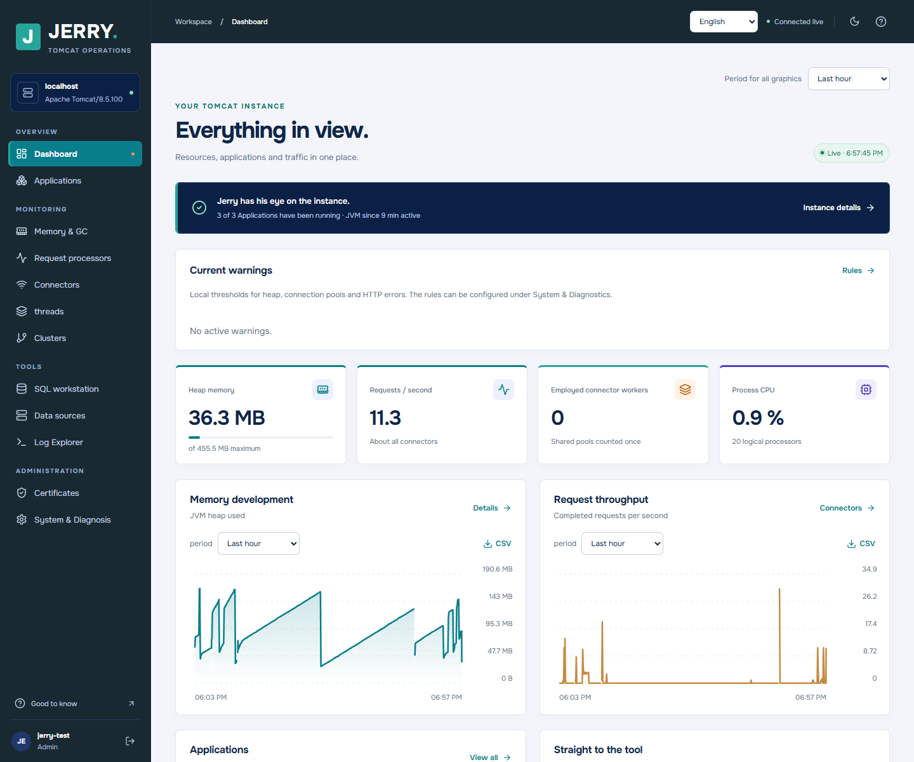
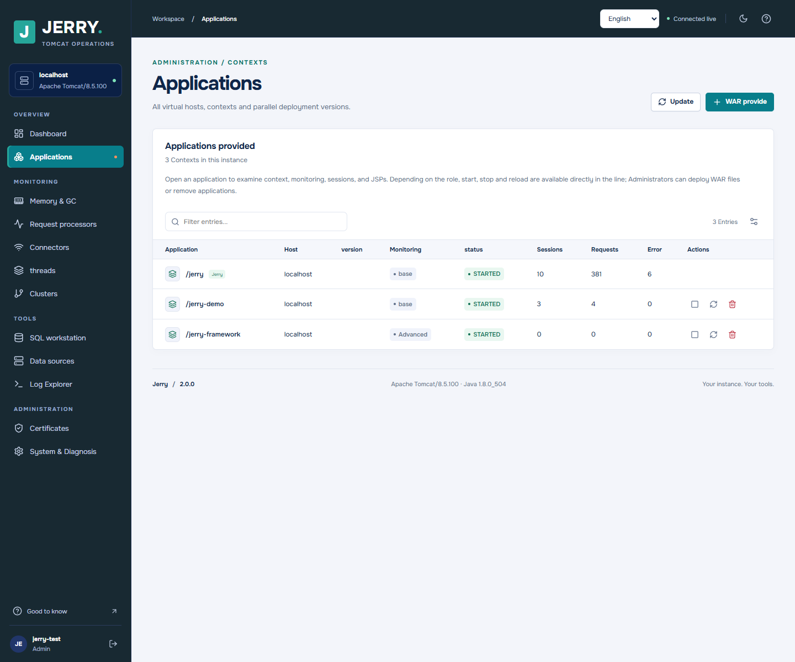
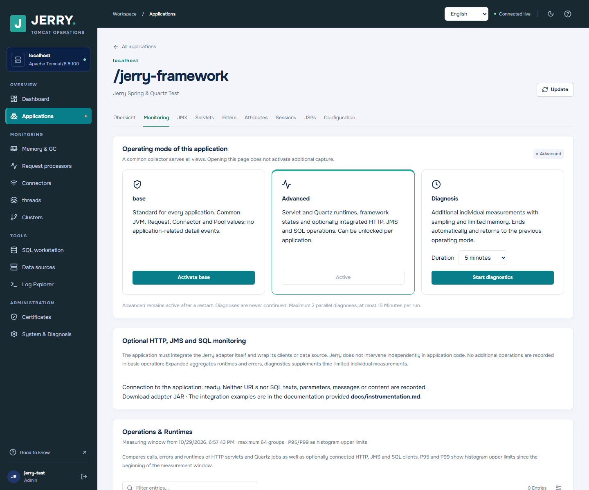
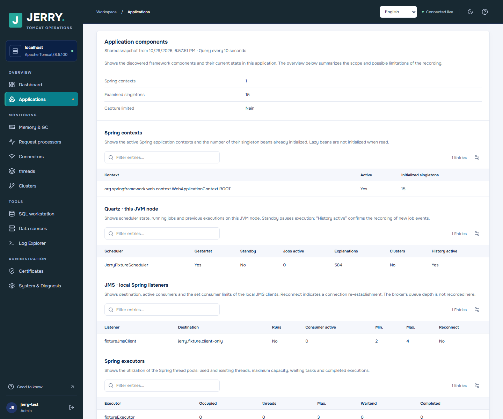
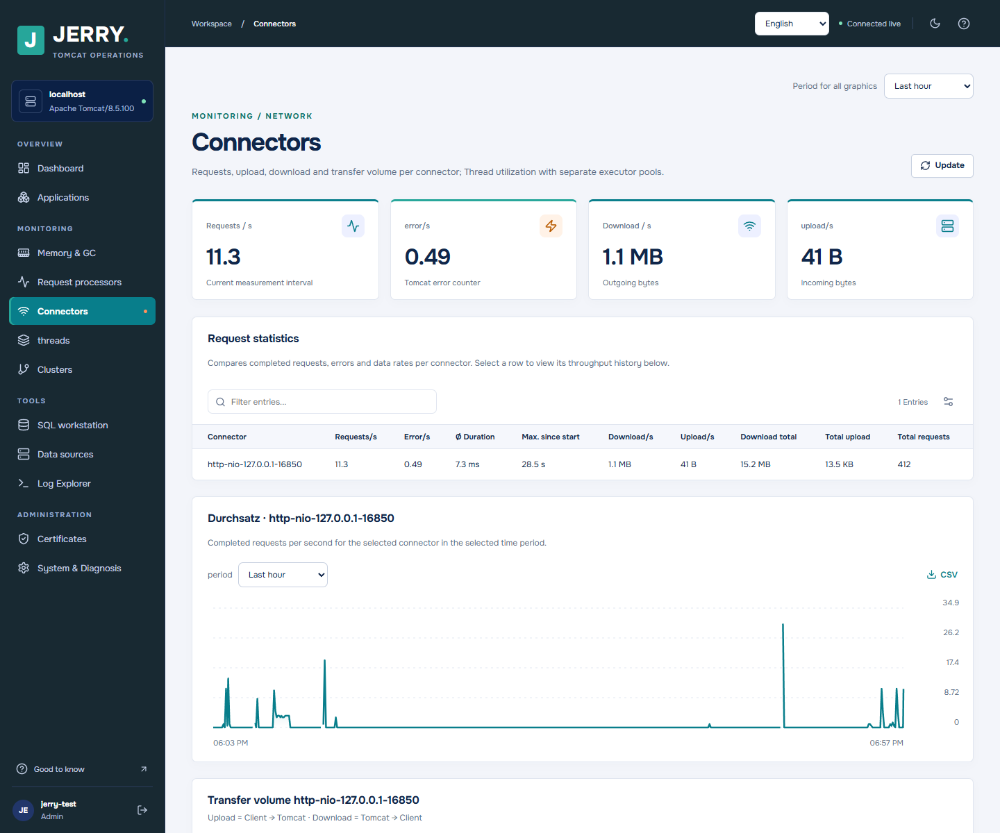
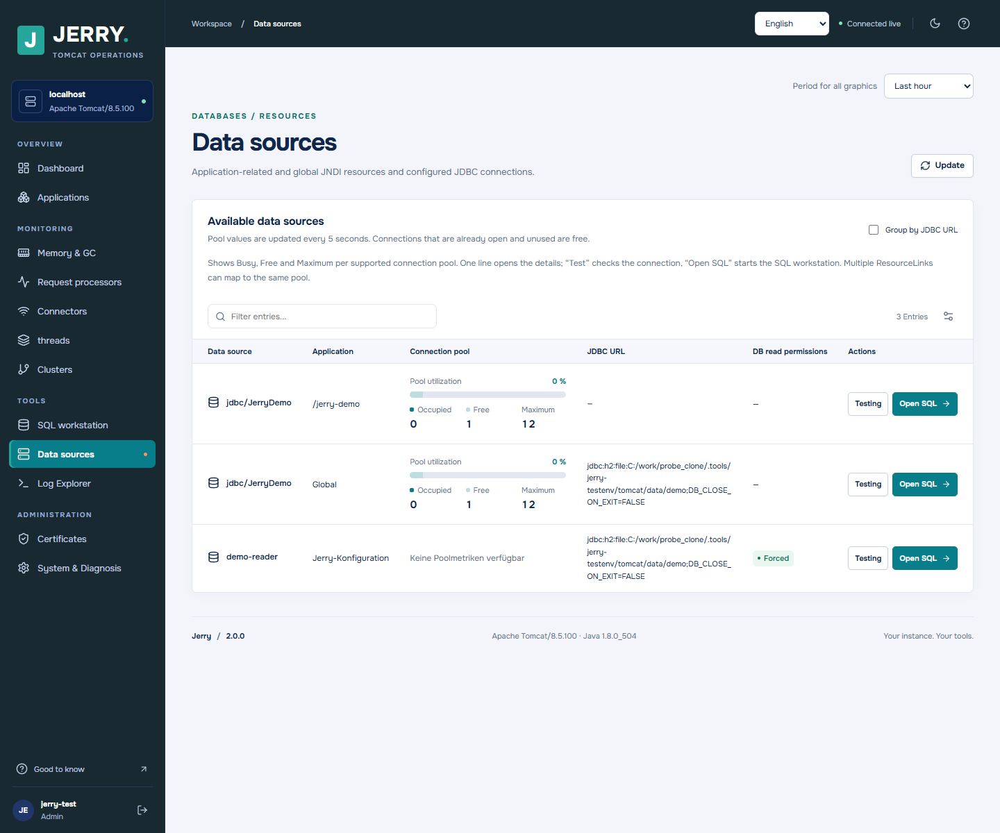
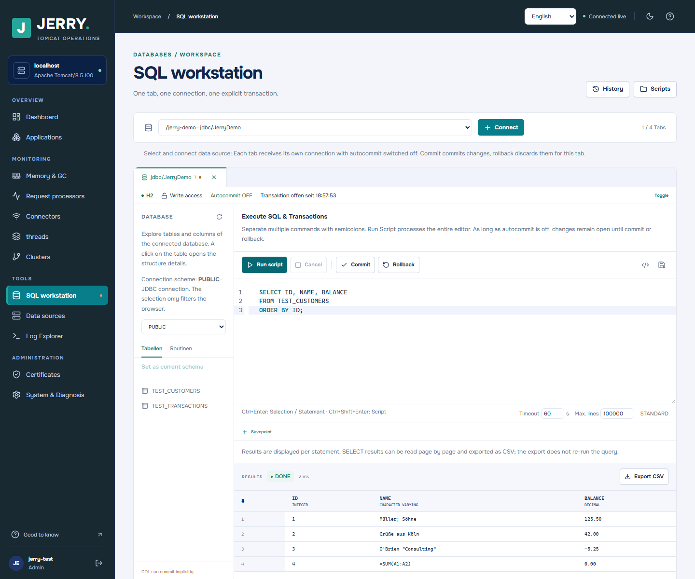
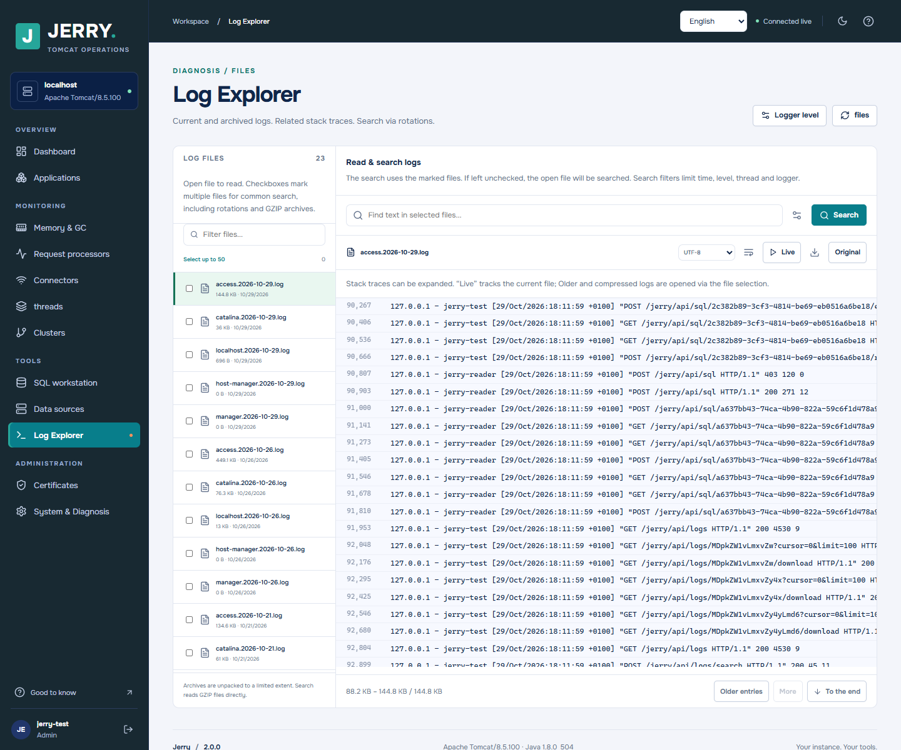

# Jerry

Jerry is a self-hosted administration and monitoring console for Apache Tomcat. It is distributed as a WAR and runs inside the Tomcat instance it manages. Jerry is independently implemented; PSI Probe was used as a functional reference, and its source code and libraries are not included.

The Jerry Wiki explains installation, security, configuration, monitoring, SQL, troubleshooting and development: [English](https://github.com/Mucumba77/Jerry/wiki/EN-Home) | [Deutsch](https://github.com/Mucumba77/Jerry/wiki).

## Choose a distribution

All platform builds share Jerry version **2.1.0**. Select the WAR that matches your Tomcat family:

| WAR | Target | Minimum Java | Servlet namespace |
| --- | --- | --- | --- |
| `jerry-2.1.0-tomcat85.war` | Tomcat 8.5 | 8 | `javax` |
| `jerry-2.1.0-tomcat9.war` | Tomcat 9.0 | 8 | `javax` |
| `jerry-2.1.0-tomcat100.war` | Tomcat 10.0 | 8 | `jakarta` |
| `jerry-2.1.0-tomcat101.war` | Tomcat 10.1 | 11 | `jakarta` |
| `jerry-2.1.0-tomcat11.war` | Tomcat 11.0 | 17 | `jakarta` |

Tomcat 8.5 and 10.0 have reached end of support; choose a supported Tomcat release where possible. The Jakarta builds are produced using Apache's Jakarta EE migration tool. Jerry uses Tomcat internals, so verify the intended patch level and providers in a staging environment before production deployment.

## Install

1. Copy the appropriate WAR to `$CATALINA_BASE/webapps/jerry.war`.
2. Assign at least the `jerry-admin` role to an account in your Tomcat Realm. [Example Realm configuration](docs/tomcat-users.example.xml). Jerry does not create a default account or password.
3. Start Tomcat and open `https://your-server/jerry/` through your secured administrative access path.

Jerry's `META-INF/context.xml` requires `privileged="true"` to inspect its host Tomcat. If an external Context descriptor overrides it, use [docs/jerry.xml](docs/jerry.xml). Grant the service account access only to the log roots and storage it needs. Configure a trusted reverse proxy and HTTPS correctly; do not expose this administrative console directly to untrusted networks. SQL users operate with the permissions of the selected database account.

The optional configuration file is `$CATALINA_BASE/conf/jerry.properties`; [docs/jerry.properties.example](docs/jerry.properties.example) lists the settings. The default data directory is `$CATALINA_BASE/data/jerry`. Credentials can be read from environment variables. Jerry has no mandatory external database or broker.

## Capabilities

- JVM, heap, GC, request processor, connector, thread, cluster and pool monitoring with local history and CSV chart exports.
- Application lifecycle, sessions, servlet mappings, JSP compilation, scoped JMX inspection and framework monitoring.
- SQL workspace with multiple tabs, schema browsing, explicit transactions, script execution, syntax highlighting, table/column/function completion and CSV export. Autocommit is off when a connection opens. Suggestions appear while typing or with Ctrl+Space; column metadata is loaded on demand for the selected schema.
- Log explorer for current, rotated and GZIP-compressed files; searches and file access are bounded to configured roots.
- Configurable local warnings for heap, observed pool usage and HTTP error rates. Warnings do not send external notifications.
- Basic monitoring is enabled by default. Extended monitoring is enabled per application, while diagnostic mode is a time-limited lease. Optional HTTP, JMS and JDBC adapters require explicit integration in the monitored application; see [instrumentation.md](docs/instrumentation.md).

The interface offers German, English, French, Spanish, Italian, Russian, Portuguese, Dutch, Polish, Turkish, Chinese, Japanese and Arabic. The selected language is stored in the browser and translation catalogs are packaged locally. Translations are machine-assisted and need community review; some dynamic messages supplied by drivers or the server may remain in their original language.

## Screenshots

These screenshots show Jerry 2.0 in an isolated Tomcat test instance with sample applications and data. Click an image to view it at full size; the [screenshot guide](docs/SCREENSHOTS.md) explains each view and its prerequisites.

| Dashboard and warnings | Deployed applications |
| --- | --- |
| [](docs/screenshots/dashboard.png) | [](docs/screenshots/applications.png) |
| **Per-application monitoring modes** | **Spring, Quartz and JMS components** |
| [](docs/screenshots/application-monitoring.png) | [](docs/screenshots/application-components.png) |
| **Connectors and traffic** | **Data sources and connection pools** |
| [](docs/screenshots/connectors.png) | [](docs/screenshots/datasources.png) |
| **SQL workspace** | **Log Explorer** |
| [](docs/screenshots/sql-workspace.png) | [](docs/screenshots/logs.png) |

## Build from source

Build with **JDK 8**, Maven 3.9 and Node.js 22 or later. The generated WARs run on the Java versions in the table above; Node.js is not needed by Tomcat. The build downloads the official Apache Jakarta migration tool as a build dependency.

```sh
export JAVA_HOME=/path/to/jdk8
sh build.sh
```

On Windows, set `JAVA_HOME` and run `./build.ps1`. Versioned WARs and their SHA-256 files are written to `dist/`. There are separate instrumentation JARs for Java EE, Jakarta EE and Jakarta Servlet applications that still use `javax.jms`. Do not mix an older instrumentation JAR with Jerry 2.0: both the Java package and the bridge identifier changed to `de.mucumba.jerry`.

The source is organized into `jerry-core`, `jerry-tomcat85` (container integration shared by the platform builds), `jerry-web`, `jerry-instrumentation`, and `frontend`. [Architecture and compatibility notes](docs/ARCHITECTURE.md) describe the boundaries and tests. A detailed German reference is retained in [docs/REFERENCE.de.md](docs/REFERENCE.de.md).

## Security and support

Use Tomcat roles to separate viewer, operator, SQL and administrator access. JDBC read-only access requires a database account that is actually restricted by the database; JDBC's advisory read-only flag is not a security boundary. Some actions, including deployment and thread interruption, affect live applications. Additional application monitoring and database statistics have overhead that depends on the workload.

See [SECURITY.md](SECURITY.md), [CONTRIBUTING.md](CONTRIBUTING.md), [NOTICE.md](NOTICE.md) and the documentation directory. The test environment in [docs/TESTUMGEBUNG.md](docs/TESTUMGEBUNG.md) is isolated and uses local fixture credentials; never reuse them for production.

## License

Jerry is licensed under the [Apache License 2.0](LICENSE). Third-party components retain their own licenses; see [NOTICE.md](NOTICE.md).
