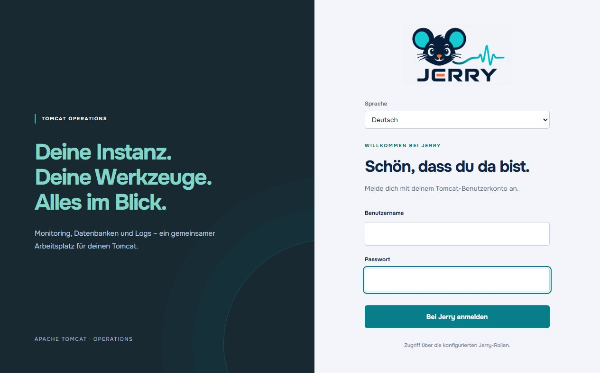
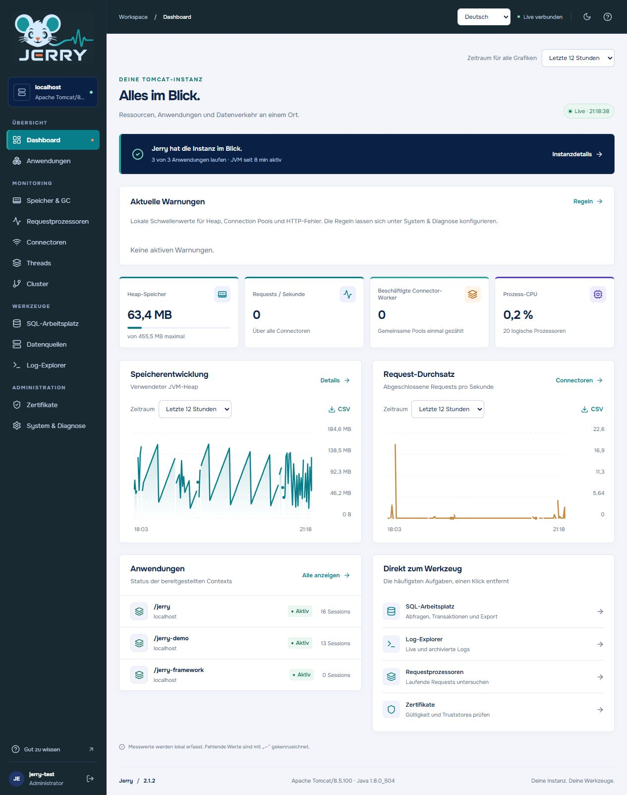
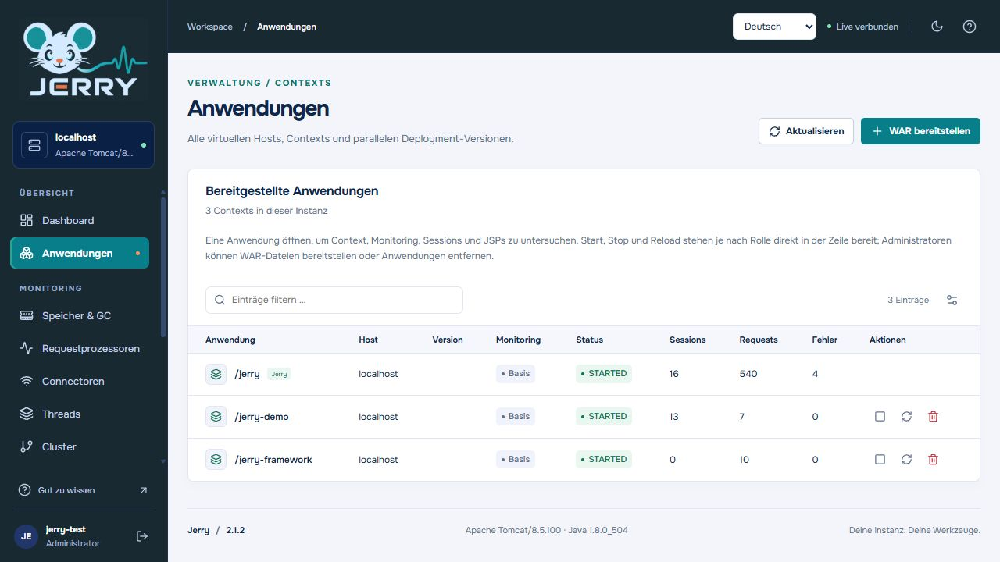
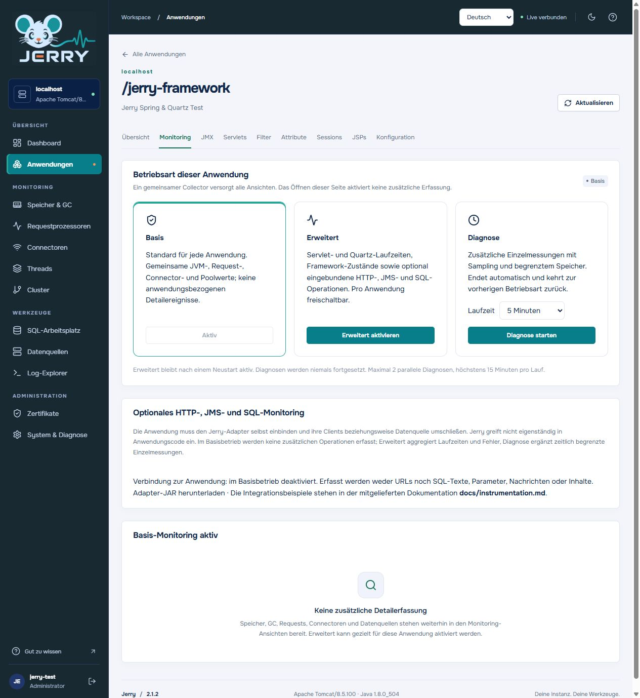
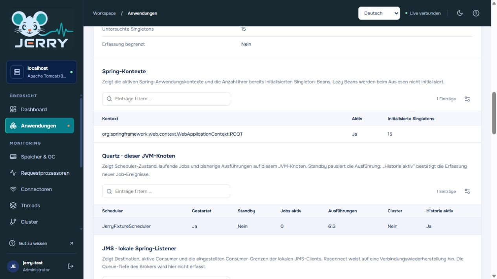
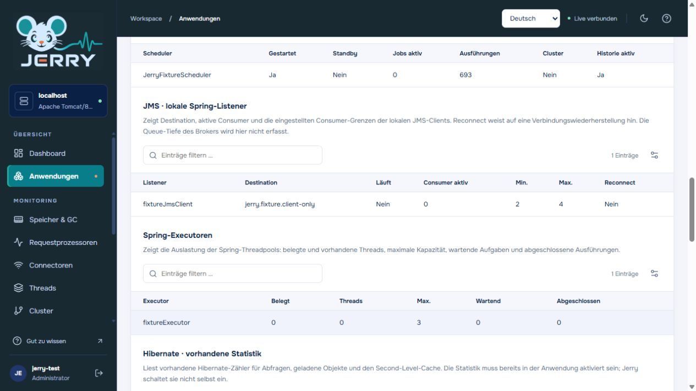
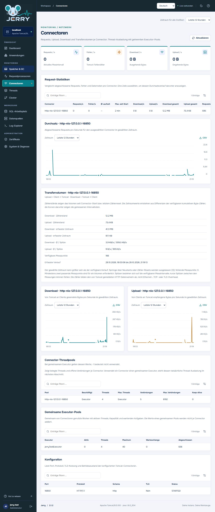
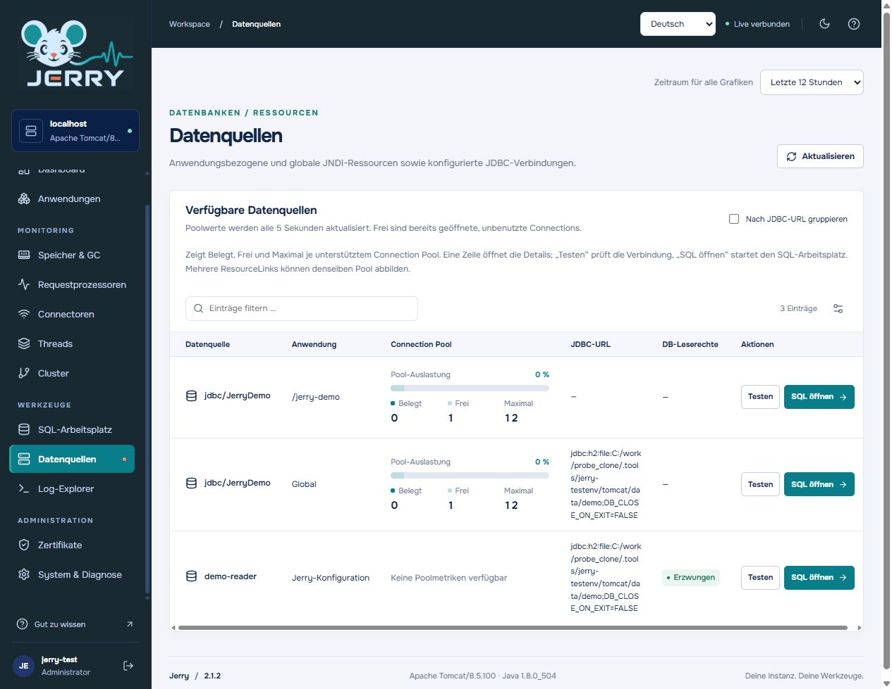
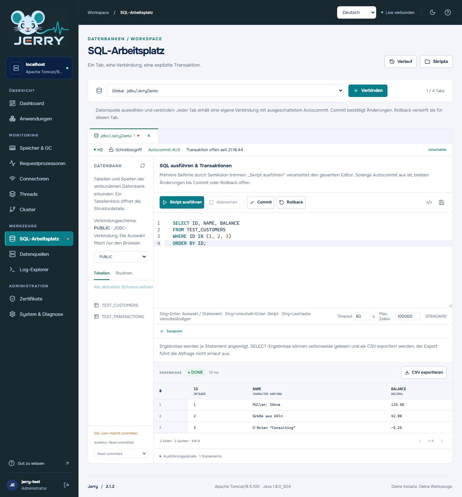
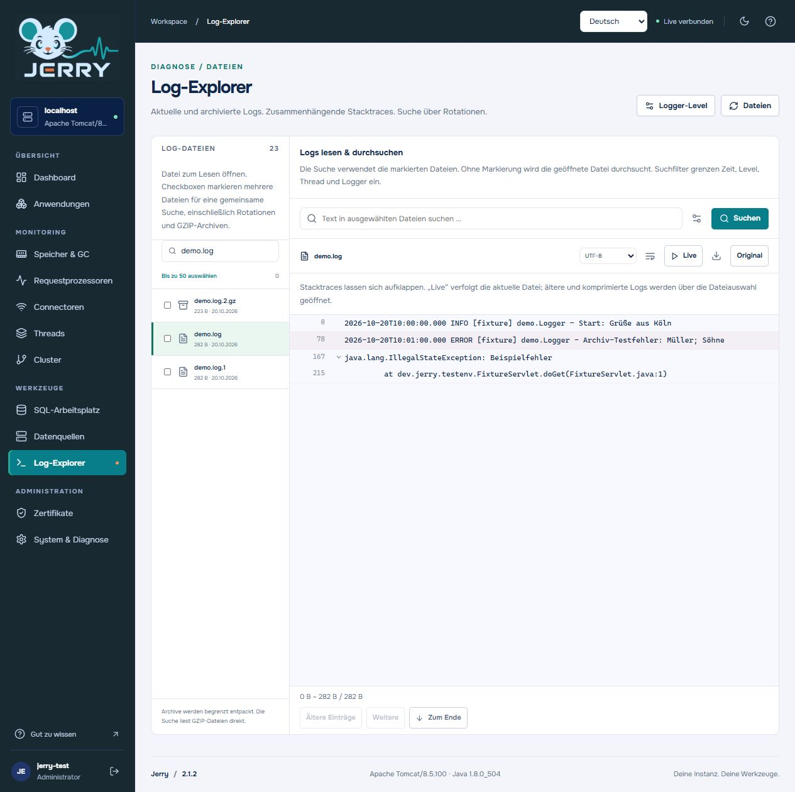

# Jerry screenshot guide

The following screenshots were captured from Jerry 2.1.2 on a local Tomcat 8.5.100 test instance. The applications, database rows, accounts and logs shown are fixtures. Metric values and the available controls depend on the connected server and the user's permissions. Select an image to open it at full size.

## Sign in

Jerry uses the Tomcat Realm for authentication. The sign-in page includes the Jerry logo and language selector; the example does not show credentials.

## Dashboard

The dashboard summarizes instance health, local threshold warnings, heap usage, connector activity and recent history. The period selectors and CSV controls apply to the displayed charts.

## Applications

The application list shows deployed contexts, their status, sessions, request counters and the selected monitoring mode. Operators can open a context; lifecycle controls depend on the assigned role.

## Application monitoring modes

Each application starts with basic monitoring. An administrator can enable extended monitoring for that application or start a time-limited diagnostic session. The screen also explains optional HTTP, JMS and SQL instrumentation; it requires an adapter in the monitored application.

## Framework components

With extended monitoring enabled, Jerry displays supported, already initialized framework components. This example includes a Spring context, a Quartz scheduler and a local Spring JMS listener. JMS metrics describe the client inside the application; they do not report broker queue depth.

The same test application exposes local JMS listeners and Spring executors:

## Connectors

Compare requests, errors and upload/download rates and cumulative volumes across connectors. Selecting a connector shows its throughput history; the chart period and CSV export are available above the graph.

## Data sources and pools

The data-source view lists available JNDI resources and configured connections. Supported pools show occupied, free and maximum connections, and each source links to the SQL workspace.

## SQL workspace

The workspace provides a SQL editor, schema browser, result grid and CSV export. Each tab has its own connection; autocommit is off when opened, with explicit commit and rollback controls. Since 2.1, completion suggests tables from the selected schema, columns after a table or common alias, and selected SQL functions. Use Ctrl+Space to open suggestions and the schema refresh button after schema changes. The pictured rows are synthetic test data.

## Log Explorer

Read and search current and older logs, including rotated and GZIP-compressed files when available. The example displays a synthetic log from the isolated test instance.

